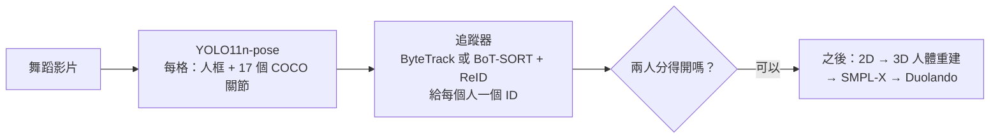
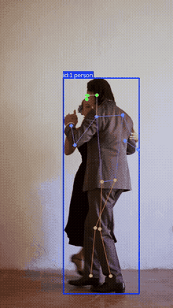
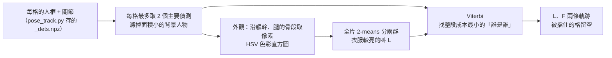
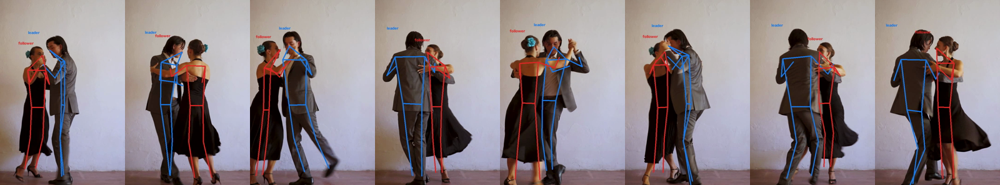
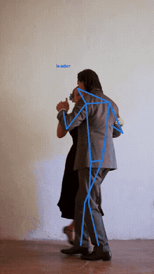

# 實驗 H：用 YOLO 姿態偵測抓雙人舞

[實驗 F](exp_f.md) 的 Duolando 只能吃 DD100 的動作捕捉資料。如果能從一般影片抓出舞者的動作，就能用網路上大量的舞蹈影片，甚至做「上傳男伴影片，AI 生成女伴」。
這個實驗先檢查最前面一步：**YOLO 姿態偵測加上多目標追蹤，能不能穩定地從雙人舞影片中分出兩個人、抓到關節**。



## 資料與模型

| 影片 | 內容 | 規格 |
|---|---|---|
| [tango](https://www.pexels.com/video/8281169/) | 一對男女跳阿根廷探戈，白牆前近拍，全身入鏡，貼身閉式舞姿 | 1080×1920，24 fps，16 秒（390 格） |
| [waltz](https://www.pexels.com/video/30755431/) | 一對年長夫婦在宴會廳跳華爾滋，人較小，背景還有其他舞者 | 2160×3840，30 fps，14 秒（448 格） |

- 兩段都是 Pexels 免費授權的影片，放在 `data/pose/`，不進 git。
- 模型是 `yolo11n-pose.pt`（6 MB，Ultralytics，AGPL-3.0），放在 `models/`。
- 影片先縮到 540×960 再送進模型（模型的輸入本來就是 640）。

## 執行

```bash
uv run python exp_h/pose_track.py data/pose/tango.mp4 data/pose/waltz.mp4
```

加上 `--tracker exp_h/botsort_reid.yaml --out out/exp_h_reid` 改用 BoT-SORT + ReID，加上 `--device cpu` 改用 CPU。
兩段影片合計約 30 秒跑完（含載入模型）。輸出畫好骨架和 ID 的影片，以及 `metrics_*.json`。

[`exp_h/pose_track.py`](../exp_h/pose_track.py) 量三件事：

1. **ID 會不會換**：影片沒有標註，所以用兩種方式檢查。
   - 用「軀幹的服裝亮度」區分男女，記錄每人的追蹤 ID 換了幾次。兩段影片都是男方淺色、女方深色。
   - 再看影格人工確認。
2. **漏抓**：每格偵測到幾個人，以及關節信心低於 0.5 的比例。
3. **速度**：每格的推論加追蹤時間（中位數）。

## 結果



完整影片：[media/exp_h_tango.mp4](media/exp_h_tango.mp4)

探戈每 2 秒一格，注意框上的 ID：


| | 探戈（近拍、貼身） | 華爾滋（遠拍、有背景舞者） |
|---|---|---|
| 只偵測到 1 人的格數 | **35%**（135/390） | 3%（13/448） |
| 偵測到 3–4 人的格數 | 1% | 18%（背景其他舞者） |
| 用掉的追蹤 ID 數（ByteTrack） | **8**（只有 2 人） | 8（含背景的人） |
| 男女 ID 互換（人工看影格確認） | **有**：id 3 在 0 秒是女方、6 秒變男方、12 秒又變回女方 | 沒有：男方一直是 id 1，女方一直是 id 2；約 9.2 秒女方被男方擋住而短暫消失，回來時仍是 id 2 |
| 舞者關節信心 < 0.5 | 15% | 21% |
| 兩人最近手腕距離 ÷ 軀幹長（中位數） | 0.14 | 0.25 |
| 速度（MPS / CPU，ms/格） | 14.5 / 22.3 | 16.6 / 24.3 |

換成 BoT-SORT + ReID（用偵測器自己的特徵比對外觀，遺失的軌跡保留 60 格）：

| | ByteTrack | BoT-SORT + ReID |
|---|---|---|
| 探戈用掉的 ID 數 | 8 | 12 |
| 探戈男方 ID 換了幾次（亮度法） | 12 | 6 |
| 探戈女方 ID 換了幾次（亮度法） | 8 | 9 |
| 速度（MPS，ms/格，探戈 / 華爾滋） | 14.5 / 16.6 | 19.6 / 24.6 |

ReID 沒有解決問題：男方較穩，但女方一樣常換，用掉的 ID 反而更多，也慢了約 40%。

**亮度法的限制**：在華爾滋中，它在 9.03 秒和 10.23 秒判定兩人 ID 互換。但人工看影格發現 ID 其實沒變，是女方被擋住時亮度判斷出錯。所以表中的「互換」以人工確認為準，亮度法的次數只當參考。

## 觀察

1. **單格的骨架品質不錯**。兩段影片中，看得到的人關節大致都對。貼身時手腕距離只有軀幹長的 0.14–0.25，可以分辨出閉式舞姿。
2. **難的是「兩人分開」，不是「抓關節」**。探戈 35% 的格數只偵測到一個人：兩人重疊時，偵測器的去重（NMS）把兩個框合成一個。人一消失再出現，追蹤器就給新的 ID，甚至把男方的舊 ID 給女方。這正是雙人舞最常見的狀況（閉式舞姿、轉圈、交錯）。
3. **遠拍反而比較穩**。華爾滋的兩人在畫面中較小、重疊較少，ID 幾乎不變。代價是背景舞者也被偵測到，要另外挑出主角。
4. **ReID 救不了**。兩人服裝顏色差很多，外觀特徵仍然不夠。問題出在偵測端：被擋住的人根本沒有框，追蹤器只能猜。
5. **速度不是問題**。MPS 上每格約 15 ms（約 65 fps），比影片本身還快。

**結論**：YOLO 姿態偵測可以當資料來源，但不能直接丟給 Duolando。至少還要補兩件事：

- **重新指派身分**：整段影片跑完後，用軌跡連續性、服裝顏色和「兩人最多兩個」的限制，把破碎的 ID 合併成男方、女方兩條。下一節已經做了，探戈的正確率從 66% 提高到 98%。
- **2D → 3D**：17 個 2D 關節要變成 SMPL-X 55 個 3D 關節，需要 GVHMR、WHAM 這類人體重建模型。它們本身也會處理遮擋，可能比 YOLO 更適合當第一步。

## 延伸：離線合併 ID

上面的問題出在追蹤器是「線上」的：每一格只能看過去。整段影片跑完後再處理，就能同時看前後、用全片的外觀統計。
[`exp_h/merge_ids.py`](../exp_h/merge_ids.py) 把破碎的 ID 合成「男方 L、女方 F」兩條軌跡：



每格列出所有可能的指派：兩個框時是「甲=L、乙=F」或反過來；一個框時是「它是 L」或「它是 F」。每個假設的成本是

$$
\text{cost} = \sum_{\text{人}} \Big( \underbrace{\lVert h - \mu_{\text{身分}} \rVert_1}_{\text{外觀}} + \underbrace{\min\!\big(\tfrac{\text{median}\lVert k - k_{\text{上次}} \rVert}{\text{軀幹長}},\ 2\big)}_{\text{位移}} \Big) ,
$$

其中 $h$ 是這個框的色彩直方圖，$\mu$ 是那一群的平均，$k$ 是關節位置，$k_{\text{上次}}$ 是這個身分上次出現的位置。
Viterbi 找整段影片總成本最小的路徑。兩項權重都是 1，沒有調參。

```bash
uv run python exp_h/merge_ids.py tango waltz      # 約 10 秒
```

### 評估

我看影格人工標出每個框是誰：探戈每 0.5 秒一格（53 人次），華爾滋每 1 秒一格（29 人次）。標註在 [`exp_h/gt_labels.json`](../exp_h/gt_labels.json)。
探戈 9.5 秒那格兩人疊在一起，看不出骨架屬於誰，所以沒標。

| 方法 | 探戈 | 華爾滋 |
|---|---|---|
| 原始追蹤 ID，**事後用標註**決定每個 ID 是誰（作弊的上限） | 66.0% | 100% |
| 只用外觀 | 94.3% | 96.6% |
| 只用位移 | 81.1% | 96.6% |
| **外觀 + 位移（Viterbi）** | **98.1%** | 96.6% |

- 探戈從 66% 提高到 98%，53 人次只錯 1 次：12.0 秒兩人合成一個框，骨架其實在女方身上，被判成男方。
- 華爾滋錯的 1 次是 13.0 秒女方的框太小，被「濾掉背景人物」的規則刪掉了。原始 ID 在這段本來就沒換，所以合併沒有加分。
- 兩種線索互補：只看位移，兩人交錯時會跟錯人；只看外觀，兩人重疊時顏色會混在一起。
- 合併後，探戈有 81% 的格數有男方骨架、85% 有女方。其餘是被擋住、根本沒有框的格，要靠之後的 3D 重建或插值補上。

合併後的探戈（藍 = leader，紅 = follower，每 2 秒一格）：





完整影片：[media/exp_h_tango_merged.mp4](media/exp_h_tango_merged.mp4)

**限制**：

- 「衣服較亮的是男方」是針對這兩段影片的命名規則。換影片時，要改成看第一格人工指定，或用身高等線索。
- 外觀分群假設兩人衣服顏色不同。穿同色衣服的情侶裝，就只能靠位移，正確率會掉到 81% 左右。
- 只有兩段、各十幾秒的影片，標註也是我一個人標的，數字只能當參考。

## 可以接著做

- **換更大的模型**：用 `yolo11s/m-pose` 或新的 YOLO26-pose，看重疊時漏抓是否減少。
- **3D 重建**：試 GVHMR 或 4D-Humans 在 8 GB Mac 上能不能跑，輸出能不能轉成 Duolando 的 SMPL-X 格式。合併好的 L/F 軌跡可以告訴重建模型「哪個人是誰」。
- **補空格**：被擋住的格用前後插值，或交給 3D 重建模型處理遮擋。
